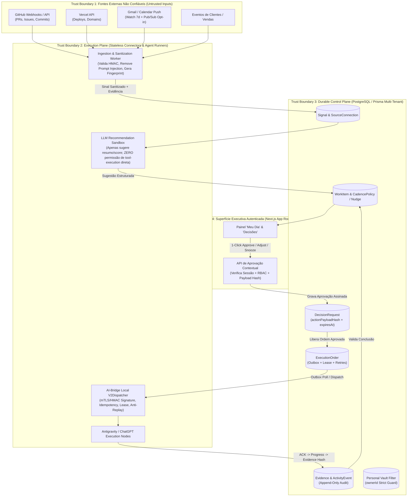

# ADR-001: Arquitetura do Módulo NexosAI Executive (Gerente Geral Executivo Proativo)

- **Status**: PROPOSTO (Fase F0 — Design & Co-Design Documental)
- **Data**: 2026-11-04
- **Ordem de Referência**: `HU-HUB-ORDER059-NEXOSAI-EXECUTIVE-CODESIGN-20261104`
- **Autores**: Antigravity & ChatGPT (HelpUS Hub Co-Design)
- **Escopo**: Módulo "NexosAI Executive" sobre a fundação Multi-Tenant do `HelpUSA/nexosai-frontend` (piloto interno HelpUS e futura comercialização SaaS B2B).

---

## 1. Contexto e Problema

O Master SuperAdmin opera simultaneamente múltiplas frentes de engenharia de software (`nexosai`, `autista`, `fit`, `books`, `rodrigocosta`, `helpus-fba`), atendimento a clientes, funil de vendas, triagem de e-mails, incubação de novas ideias e compromissos particulares.

Ferramentas tradicionais de IA operam sob paradigma **reativo** (aguardam prompt humano) e listas de tarefas convencionais sofrem de **passividade e fadiga de manutenção**. O objetivo do **NexosAI Executive** é atuar como um **Gerente Geral Executivo Proativo (AI Chief of Staff)** que:
1. Inspeciona continuamente sinais omnicanal (repositórios, deploys, e-mails opt-in, CRM/clientes e notas rápidas).
2. Prioriza de forma determinística e explicável o que não pode ser esquecido.
3. Entrega o trabalho pré-encaminhado (rascunhos ou ordens técnicas prontas) sob governança estrita de aprovação humana.
4. Despacha ordens aprovadas para execução autônoma por agentes (Antigravity e ChatGPT) e exige **evidência verificável** antes de declarar qualquer tarefa concluída.

---

## 2. Confronto e Consolidação: Proposta Original (6 Pilares) vs. Extensões da Ordem 059

| Pilar Original (Antigravity) | Extensão Arquitetural (ChatGPT — Ordem 059) | Decisão Consolidada no ADR-001 |
| :--- | :--- | :--- |
| **1. Ingestão Omnicanal de Atrito Zero** | Separação formal de `SourceConnection` (sem segredos em texto claro no banco) e normalização em `Signal` com `fingerprint` único e `summaryRedacted`. | **Adotado**: Toda entrada externa gera um `Signal` imutável e deduplicado por `(organizationId, fingerprint)`. OAuth tokens residem apenas em cofre/secret manager externo referenciado por `secretReference`. |
| **2. Motor de Cadência e Empurrão Ativo** | Score explicável `0–100` parametrizado (30% impacto, 25% urgência, 20% custo de esquecimento, 15% desbloqueio, 10% confiança - penalidade de incerteza) + `CadencePolicy` e `Nudge` persistidos. | **Adotado**: Rituais padrão em `America/Fortaleza` (08:00 Briefing Top 3–5, 13:00 Radar de Desbloqueio máx. 3, Segunda-feira Varredura Anti-Esquecimento) com `quietHours` e `cooldown` obrigatórios. |
| **3. Orquestração Direta com Agentes** | Separação estrita entre **Control Plane** (PostgreSQL/Prisma) e **Execution Plane** (Connectors + AI-Bridge V2). `ACK` nunca equivale a `DONE`. | **Adotado**: Máquina de estados explícita onde `IN_PROGRESS -> VERIFICATION -> DONE` exige registro na tabela `Evidence` com hash e status de verificação. |
| **4. Visão 360º (Negócios & Vida Pessoal)** | Segregação de **Vida Pessoal** em Vault Privado (`sensitivity = PERSONAL_VAULT`), isolado de membros comuns do tenant. | **Adotado**: Itens com `sensitivity = PERSONAL_VAULT` exigem `ownerId == session.user.id` além do vínculo organizacional, impedindo exposição acidental a operadores/viewers da empresa. |
| **5. Anti-Fadiga e Ação em 1 Clique** | Classificação de risco em 4 tiers (`AUTO_READ`, `AUTO_SAFE`, `APPROVAL_REQUIRED`, `PROHIBITED`) e `DecisionRequest` vinculada ao `actionPayloadHash`. | **Adotado**: Nenhuma ação com efeito colateral externo ou despacho na AI-Bridge ocorre sem `DecisionRequest` aprovada pelo usuário autorizado, com validação criptográfica do hash do payload e expiração (`expiresAt`). |
| **6. Fundação Nativa SaaS Multi-Tenant** | Reuso integral de `Organization`, `OrganizationMembership`, `UserRole`, `Agent`, `Conversation` e `AuditLog` já presentes em `prisma/schema.prisma` (PR #31). | **Adotado**: Evolução 100% aditiva sobre o modelo do PR #31, sem quebrar compatibilidade e preservando os guardas de isolamento `N1-B`. |

---

## 3. Arquitetura: Control Plane vs. Execution Plane e Fronteiras de Confiança (Trust Boundaries)

---

## 4. Decisões Arquiteturais Chave e Trade-offs

### 4.1. Orquestração de Filas e Workflows Duráveis: Transactional Outbox vs. Temporal.io
- **Decisão**:
  - **Fases F1A, F1B e F1C (Piloto Interno e Dogfooding)**: Utilizar **PostgreSQL Transactional Outbox + Lease/Lock Table (`ExecutionOrder` e `Nudge`)** acionados por **Vercel Cron** + Worker dedicado local/híbrido.
  - **Fase F2 (Escala SaaS B2B Multi-Tenant)**: Avaliar migração do motor de execução para **Temporal.io** caso o volume ultrapasse `10.000 WorkItems ativos/dia` ou exija sagas distribuídas de longa duração entre múltiplos provedores.
- **Racional / Trade-off**: Introduzir um cluster Temporal.io na Fase F1 aumentaria o custo fixo de infraestrutura e a complexidade operacional antes da validação de produto. O padrão Transactional Outbox com `SELECT ... FOR UPDATE SKIP LOCKED`, `idempotencyKey`, `leaseExpiresAt` e `retries` com backoff exponencial no PostgreSQL/Neon já atende 100% dos requisitos de durabilidade e idempotência para o piloto a custo marginal zero.

### 4.2. Autoridade do LLM vs. Motor de Políticas Determinístico
- **Decisão**: O LLM atua **exclusivamente como classificador assistivo e redator de rascunhos/resumos**. Ele **não possui credenciais nem capacidade de invocar ferramentas com efeitos colaterais (`side effects`)**.
- **Racional / Trade-off**: E-mails externos, issues do GitHub e mensagens de clientes são vetores clássicos de **Indirect Prompt Injection (OWASP LLM01 / Agentic Top 10)**. Ao isolar o LLM de chamadas diretas de API e exigir que toda transição de `APPROVAL_REQUIRED` passe pelo validador determinístico do Control Plane (`DecisionRequest` com verificação de `actionPayloadHash` pelo humano), eliminamos o risco de execução arbitrária induzida por conteúdo externo.

### 4.3. Isolamento do Cofre Pessoal (`PERSONAL_VAULT`) dentro da Arquitetura Multi-Tenant
- **Decisão**: Criar o nível de sensibilidade `PERSONAL_VAULT` nas entidades `Signal` e `WorkItem`. Qualquer query a registros com `sensitivity = PERSONAL_VAULT` exige predicado duplo obrigatório no banco: `organizationId = :orgId AND ownerId = :currentUserId`.
- **Racional / Trade-off**: Permite que o gestor utilize o mesmo painel executivo ("Meu Dia") para compromissos pessoais e empresariais sem jamais expor dados particulares a outros membros (`ADMIN`, `OPERATOR`, `VIEWER`) da mesma `Organization`.

### 4.4. Renovação de Watch do Gmail e Reconciliação Periódica
- **Decisão**: Nas integrações Gmail API Push (`users.watch` via Cloud Pub/Sub), um job de manutenção renova a subscrição a cada **5 dias** (antes do limite de expiração de 7 dias da Google) e executa reconciliação incremental via `historyId` (`syncCursor` em `SourceConnection`).
- **Racional / Trade-off**: Garante zero perda de sinais mesmo se uma notificação webhook sofrer falha transitória de rede.

---

## 5. Custos Estimados e Cronograma de Engenharia (Estimativas Preliminares)

| Fase | Escopo Resumido | Custo Infra Estimado (Mensal) | Janela Estimada |
| :--- | :--- | :--- | :--- |
| **F0 (Atual)** | Co-design, ADR-001, Schema proposto, Contratos, Wireframes e Backlog em PR Draft separado. | US$ 0 (Design Only) | Concluído nesta entrega |
| **F1A (Piloto Read-Only)** | Monitoramento de repositórios GitHub/Vercel + Captura manual de ideias/tarefas + Briefing "Meu Dia" persistente (Feature Flag `OFF` por padrão). | US$ 0 (Usa Neon Staging/Free + Vercel atual) | 1 a 2 semanas |
| **F1B (Conectores Opt-In + Bridge)** | Gmail/Calendar Opt-In, Clientes/Vendas, Rascunhos assistidos e despacho aprovado para AI-Bridge Local V2. | US$ 5 – US$ 20 (Tokens LLM + Pub/Sub leve) | 2 a 3 semanas |
| **F1C (Dogfooding 30 Dias)** | Uso diário real pelo Master SuperAdmin, calibragem de pesos do score e corte de falsos positivos. | US$ 10 – US$ 25 | 30 dias corridos |
| **F2 (SaaS Comercial B2B)** | Onboarding self-service por tenant, LGPD/DSAR, quotas/billing e observabilidade multi-tenant. | Escala conforme clientes | Pós-aprovação do Gate F1C |
