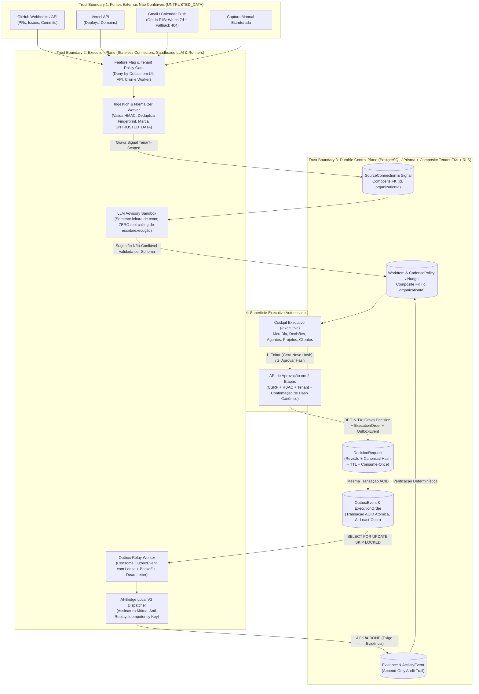

# ADR-001: Arquitetura do Módulo NexosAI Executive (Gerente Geral Executivo Proativo)

- **Status**: PROPOSTO — REVISÃO HARDENING ORDEM 060 (Fase F0 — Design & Co-Design Documental; **Não equivale à aprovação D1 nem autoriza início de F1A**)
- **Data**: 2026-11-04 (Revisão v1.1 — Hardening Ordem 060)
- **Ordens de Referência**: `HU-HUB-ORDER059-NEXOSAI-EXECUTIVE-CODESIGN-20261104`, `HU-HUB-ORDER060-EXECUTIVE-ADR-HARDENING-20261104`
- **Linhagem de Branch (Stacked PR Dependency)**: Este PR Draft ([PR #32](https://github.com/HelpUSA/nexosai-frontend/pull/32), branch `docs/nexosai-executive-codesign-order059-20261104`) é **stacked** diretamente sobre a branch candidata do [PR #31](https://github.com/HelpUSA/nexosai-frontend/pull/31) (`test/g3c-strict-release-candidate-20261103`, HEAD `bb1830976ac9a16066400b0839a39be83cac8bef`), contendo exclusivamente 4 arquivos documentais em `docs/executive/`. Não pode ser mergeado antes da deliberação do PR #31 e do aceite executivo formal D1.

---

## 1. Matriz de Conformidade e Mudanças da Revisão Técnica (Ordem 060 — `PASS / OPEN / DECISION`)

| Item | Exigência de Hardening (Ordem 060) | Status | Resolução Documental Aplicada (v1.1) |
| :--- | :--- | :---: | :--- |
| **H-01** | **Integridade Relacional Multi-Tenant (Composite FKs)** | **PASS** | Todas as relações entre entidades tenant-scoped em `SCHEMA-PROPOSAL-NEXOSAI-EXECUTIVE.prisma.md` agora declaram `@@unique([id, organizationId])` nas tabelas pai e chaves estrangeiras compostas `fields: [<fkId>, organizationId], references: [id, organizationId]` nas tabelas filhas, impedindo associação cruzada entre organizações no nível do SGBD, somado a defesa em profundidade via PostgreSQL RLS. |
| **H-02** | **Isolamento Real do Personal Vault & Escopo MVP F1A** | **DECISION / PASS** | Explicitado que `sensitivity = PERSONAL_VAULT` + filtro `ownerId` é apenas controle lógico de aplicação e **não protege** contra acesso de infraestrutura, dumps ou backups sem criptografia de envelope (AEAD AES-256-GCM com DEK por usuário) ou segregação de storage. **Ingestão de Vida Pessoal ADIADA para fora do MVP F1A** até revisão e aprovação específica de privacidade/criptografia. |
| **H-03** | **Outbox Transacional Formal (`OutboxEvent` & At-Least-Once)** | **PASS** | Adicionada a tabela explícita `OutboxEvent` gravada na mesma transação ACID das mutações de `WorkItem`/`DecisionRequest`/`ExecutionOrder`. Semântica declarada como **`at-least-once`** (não `exactly-once`), exigindo deduplicação idempotente no receptor, lease com expiração, retries com backoff exponencial + jitter e fila `DEAD_LETTER`. |
| **H-04** | **Aprovação de Payload Editado (`ADJUSTED_AND_APPROVED`)** | **PASS** | Fluxo corrigido para **duas etapas obrigatórias**: se o executivo editar um rascunho/ordem, o sistema persiste uma nova revisão (`revisionNumber + 1`), recalcula o `canonicalPayloadHash` sobre o JSON canônico RFC 8785, exibe o diff visual e exige confirmação explícita vinculada ao **novo hash** (com TTL estrito, token `consume-once`, proteção CSRF e checagem RBAC + tenant). |
| **H-05** | **Defesa contra Prompt Injection Semântico** | **PASS** | Explicitado que truncamento/remoção de HTML (`summaryRedacted`) **não elimina comandos maliciosos semânticos** em linguagem natural. Todo dado externo é marcado como `UNTRUSTED_DATA` em envelopes XML/JSON segregados, o LLM opera com **zero tool-calling de escrita/execução**, e o Policy Engine determinístico bloqueia qualquer transição sem `DecisionRequest` humana. |
| **H-06** | **Revisão de Estimativas de Custo e Garantias Operacionais** | **PASS** | Removidas afirmações absolutas ("custo zero", "100% dos requisitos", "zero perda"). Documentados limites reais do Neon Free Tier (0.5 GB storage, compute hours/autosuspend), limites de invocação do Vercel Cron e expiração de `historyId` do Gmail (`HTTP 404`), que exige fallback de reconciliação por janela de tempo. |
| **H-07** | **Gates de Feature Flag (UI, API, Cron, Workers) e Independência de DNS** | **PASS** | Definido gate global e por tenant (`NEXOSAI_EXECUTIVE_ENABLED` + `ExecutiveWorkspace.featureFlagEnabled = false` por padrão) que nega execução em **4 superfícies**: UI, rotas de API, endpoints de Cron e Workers de fila. Testes unitários e de integração F1A rodam localmente/CI sem depender do DNS externo da Ordem 058. Nenhuma migration será criada ou rodada antes da Decisão D1. |
| **H-08** | **Cadências, Timezone/DST, Rate Limit e Pausa como Defaults Propostos** | **DECISION / PASS** | Horários (`08:00`, `13:00`, Segunda `08:30`, `quietHours 22:00–07:00` em `America/Fortaleza`) tratados estritamente como **defaults propostos sujeitos à Decisão D2**. Especificadas regras de conversão IANA/DST, deduplicação por janela de agendamento, rate limit e pausa temporária (`pauseUntil`). |

---

## 2. Contexto e Problema

O Master SuperAdmin coordena simultaneamente diversas aplicações de software (`nexosai`, `autista`, `fit`, `books`, `rodrigocosta`, `helpus-fba`), atendimento a clientes, funil de vendas, triagem de e-mails e incubação de novas ideias.

Assistentes de IA puramente reativos dependem que o operador lembre de cada frente e inicie a conversa. O módulo **NexosAI Executive** projeta um **Control Plane Durável** acoplado a um **Execution Plane Governado** para:
1. Capturar e normalizar sinais de repositórios, deploys, clientes e notas rápidas sob rigoroso isolamento por organização.
2. Calcular scores explicáveis (`0–100`) que destaquem o custo de esquecimento e o poder de desbloqueio.
3. Preparar rascunhos ou ordens técnicas prontas sob classificação de risco determinística (`AUTO_READ`, `AUTO_SAFE`, `APPROVAL_REQUIRED`, `PROHIBITED`).
4. Despachar ordens aprovadas via `OutboxEvent` transacional e exigir **evidência verificada (`Evidence`)** antes de transicionar qualquer item para `DONE`.

---

## 3. Arquitetura: Control Plane vs. Execution Plane e Fronteiras de Confiança (Trust Boundaries)

---

## 4. Decisões Arquiteturais e Limitações Operacionais Explícitas

### 4.1. Integridade Relacional Multi-Tenant: Chaves Compostas + RLS
- **Problema**: Incluir apenas `organizationId` em cada tabela permite que um bug de aplicação ou worker associe um `WorkItem` da `Org A` a um `Signal`, `DecisionRequest` ou `BlockedBy WorkItem` pertencente à `Org B`.
- **Decisão**:
  1. Todas as tabelas pai (`SourceConnection`, `Signal`, `WorkItem`, `DecisionRequest`, `CadencePolicy`, `Evidence`) declaram constraint única composta `@@unique([id, organizationId])`.
  2. Todas as tabelas filhas referenciam obrigatoriamente o par `(fkId, organizationId)` via `@relation(fields: [fkId, organizationId], references: [id, organizationId])`. Assim, o próprio PostgreSQL rejeita no nível de chave estrangeira qualquer tentativa de vínculo cross-tenant.
  3. Como defesa em profundidade (Fase F1B/F2), habilitar políticas de **Row-Level Security (RLS)** no PostgreSQL vinculadas à variável de sessão `app.current_organization_id`.

### 4.2. Isolamento de Dados Pessoais (`PERSONAL_VAULT`) e Adiamento no MVP F1A
- **Limitação Real**: Filtrar linhas por `sensitivity = PERSONAL_VAULT AND ownerId = :userId` na camada de aplicação protege contra leitura por outros usuários na UI/API, mas **não constitui um cofre criptográfico** — administradores de banco de dados, snapshots de backup no Neon ou logs de query ainda teriam acesso ao texto em claro se armazenado sem cifragem.
- **Decisão**:
  1. **Adiamento no MVP F1A**: A ingestão de dados da categoria `PERSONAL` (`PERSONAL_VAULT`) fica **fora do escopo do piloto F1A**, mantendo o foco inicial exclusivamente em projetos de software e itens operacionais de negócios.
  2. **Requisito para Habilitação Futura (F1B/F2)**: Antes de ativar o `PERSONAL_VAULT`, exigir **Envelope Encryption em nível de aplicação (AEAD AES-256-GCM)** nos campos `title`, `summaryRedacted`, `nextAction` e `rawMetadataJson`, utilizando uma Data Encryption Key (DEK) exclusiva por usuário envelopada por chave mestra externa (KMS) ou derivada de segredo do titular, além de termo de consentimento explícito por fonte.

### 4.3. Transactional Outbox (`OutboxEvent`) com Semântica `At-Least-Once`
- **Problema**: Atualizar o estado de um `WorkItem` ou `DecisionRequest` e tentar despachar uma chamada HTTP/Bridge fora de um outbox formal causa perda de mensagens ou inconsistência em caso de falha do processo.
- **Decisão**:
  1. Toda transição que gere efeito externo (despacho de `ExecutionOrder` ou envio de `Nudge`) insere atomicamente um registro na tabela `OutboxEvent` dentro da **mesma transação de banco (`prisma.$transaction`)**.
  2. O worker de despacho consome `OutboxEvent` com `SELECT ... FOR UPDATE SKIP LOCKED`, adquirindo um lease temporário (`lockedUntil`).
  3. **Semântica Real**: O modelo garante entrega **`at-least-once`** (pelo menos uma vez), e não `exactly-once`. Portanto, todo receptor (AI-Bridge Local V2 ou conector de notificação) é obrigado a implementar deduplicação idempotente por `(organizationId, idempotencyKey)`.

### 4.4. Estimativas Operacionais e Limitações de Provedores (Sem Garantias Absolutas)

| Componente | Custo Estimado (Piloto F1A/F1B) | Limitações Técnicas e Modos de Falha Conhecidos | Estratégia de Mitigação Projetada |
| :--- | :--- | :--- | :--- |
| **Neon PostgreSQL (Staging / Free Tier)** | US$ 0 a US$ 19/mês (caso escale para plano Launch) | Plano Free possui teto de **0.5 GB de armazenamento**, limite mensal de compute hours e latência de *cold start* (~500ms–2s após autosuspend). | Índices enxutos, retenção limitada de payloads brutos (`rawMetadataJson` truncado), e paginação estrita. Se compute hours excederem 80% da franquia, requer upgrade aprovado para plano pago. |
| **Vercel Cron & Serverless Functions** | Incluso no plano atual (sujeito a limites de invocação/duração) | Vercel Cron no plano Hobby/Pro possui limites de frequência e timeout de execução por invocação (10s a 60s/300s conforme plano). | Workers processam lotes pequenos e limitados (`LIMIT 20` por execução) com cursor persistido, evitando timeouts de função. |
| **Gmail API Push (`users.watch` + Pub/Sub)** | US$ 0 a US$ 5/mês (Pub/Sub + tokens de resumo) | 1. Subscrição `watch` expira obrigatoriamente em no máximo **7 dias**. 2. O cursor `historyId` pode expirar no Gmail retornando **`HTTP 404 Not Found`** em `users.history.list`. | 1. Job de renovação preventiva a cada 5 dias. 2. Tratamento determinístico de `HTTP 404` no `historyId`: aciona fallback automático de **reconciliação por janela temporal** (`q: after:<lastSyncTimestamp>`) com deduplicação por `fingerprint`. |
| **Inferência LLM (Classificação/Resumo)** | US$ 5 a US$ 25/mês (dependendo do volume de sinais) | Rate limits (RPM/TPM), indisponibilidade transitória da API e alucinação de prioridades. | O cálculo base do `priorityScore` funciona com heurísticas determinísticas mesmo se o LLM estiver offline; o LLM apenas enriquece o resumo textual com orçamento diário de tokens por tenant. |
