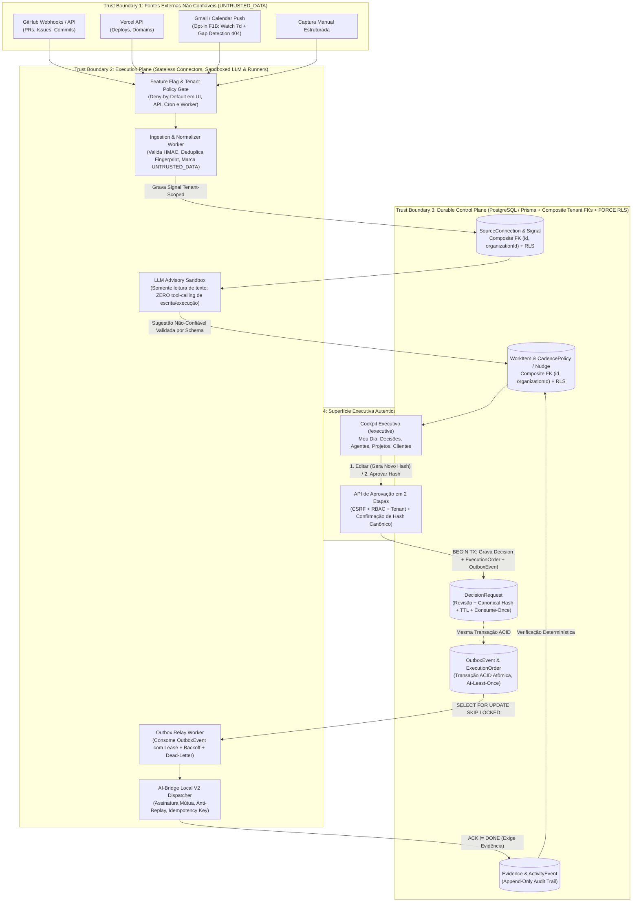

# ADR-001: Arquitetura do Módulo NexosAI Executive (Gerente Geral Executivo Proativo)

- **Status**: FECHAMENTO DOCUMENTAL F0 — REVISÃO v1.2 ORDEM 061 (**Aguardando Decisão Executiva D1; F1A NÃO INICIADA e NÃO AUTORIZADA ainda**)
- **Data**: 2026-11-04 (Revisão v1.2 — Fechamento F0 Ordem 061)
- **Ordens de Referência**: `HU-HUB-ORDER059-NEXOSAI-EXECUTIVE-CODESIGN-20261104`, `HU-HUB-ORDER060-EXECUTIVE-ADR-HARDENING-20261104`, `HU-HUB-ORDER061-NEXOSAI-EXECUTIVE-F0-REVIEW-CLOSURE-20261104`
- **Linhagem de Branch (Stacked PR Dependency)**: Este PR Draft ([PR #32](https://github.com/HelpUSA/nexosai-frontend/pull/32), branch `docs/nexosai-executive-codesign-order059-20261104`) é **stacked** diretamente sobre a branch candidata do [PR #31](https://github.com/HelpUSA/nexosai-frontend/pull/31) (`test/g3c-strict-release-candidate-20261103`, HEAD `bb1830976ac9a16066400b0839a39be83cac8bef`), contendo exclusivamente 4 arquivos documentais em `docs/executive/`. Qualquer implementação futura da Fase F1A (após autorização D1) ocorrerá em **novo Draft PR separado**, jamais misturando código de runtime no PR #32 ou no PR #31.

---

## 1. Matriz Consolidada de Fechamento F0 (Ordens 059, 060 e 061 — `PASS / OPEN / DECISION`)

| Item | Controle / Ajuste Residual (Ordens 060 & 061) | Status | Resolução Documental Consolidada (v1.2) |
| :--- | :--- | :---: | :--- |
| **H-01 / R-61.1** | **Integridade Relacional Multi-Tenant, Threat Model F1A e Gate RLS desde F1A** | **PASS** | Chaves compostas `@@unique([id, organizationId])` e FKs compostas `@relation(fields: [<fkId>, organizationId], references: [id, organizationId])` validadas no `prisma validate`. **Ajuste Ordem 061**: como F1A já persiste `WorkItem` e `Signal` tenant-scoped, **PostgreSQL RLS (`ENABLE` + `FORCE ROW LEVEL SECURITY`) é antecipado como Gate Obrigatório já na Fase F1A** (junto ao guard de aplicação `N1-B` e às FKs compostas), com bateria adversarial real em PostgreSQL efêmero no CI. |
| **H-02** | **Isolamento do Personal Vault & Escopo MVP F1A** | **DECISION / PASS** | Explicitado que filtro lógico (`ownerId`) não substitui Envelope Encryption (AEAD AES-256-GCM por usuário) contra acessos de infra/backups. **Ingestão de Vida Pessoal ADIADA para fora do MVP F1A** (`personalVaultEnabled = false`). |
| **H-03** | **Outbox Transacional Formal (`OutboxEvent` & At-Least-Once)** | **PASS** | Modelo explícito `OutboxEvent` na mesma transação ACID (`prisma.$transaction`), semântica `at-least-once`, lease `FOR UPDATE SKIP LOCKED`, backoff exponencial + jitter, `DEAD_LETTER` e deduplicação idempotente no receptor. |
| **H-04** | **Aprovação de Payload Editado em 2 Etapas (`ADJUSTED_AND_APPROVED`)** | **PASS** | Edição gera nova revisão (`revisionNumber + 1`), recalcula `canonicalPayloadHash` (RFC 8785), exibe diff estruturado e exige confirmação explícita do novo hash (`consume-once`, TTL, CSRF, RBAC+tenant). |
| **H-05** | **Defesa contra Prompt Injection Semântico** | **PASS** | Dados externos isolados como `UNTRUSTED_DATA` (`untrustedTextSummary`), LLM em sandbox sem ferramentas de escrita/execução (`tools: []`), e Policy Engine determinístico exigindo `DecisionRequest` humana. |
| **H-06 / R-61.2** | **Custos, Limites Reais e Detecção de Lacunas (`Gap Detection`) no Gmail 404** | **PASS** | **Ajuste Ordem 061**: Removida qualquer promessa de reconciliação "sem perder sinais" após expiração de `historyId` (`HTTP 404`). Especificado protocolo de **Gap Detection** (`HISTORY_GAP_DETECTED`), janela temporal ajustável de recuperação, registro de evidência da lacuna no `AuditLog`/`ActivityEvent` e alerta explícito na UI quando mensagens deletadas durante a indisponibilidade não puderem ser recuperadas. |
| **H-07 / R-61.3 / R-61.4** | **Prova Reprodutível `prisma validate`, Gate F1A em Novo Draft PR e Checklist GO/NO-GO** | **PASS** | Documentada reprodução exata do `prisma validate` (`prisma@6.19.3`, Node `v24.18.0`, env dummy não-sensível, Exit `0`). Definido Checklist GO/NO-GO completo para o futuro PR isolado da Fase F1A (que permanece `NOT_STARTED` até decisão D1). |
| **H-08 / D1–D4** | **Decisões Exclusivas do Master SuperAdmin (Sem Presunção de Aceite)** | **DECISION** | **D1** (Aceite do ADR-001 e autorização para iniciar F1A), **D2** (Horários propostos `08:00`/`13:00`/Seg `08:30` e `quietHours 22:00–07:00` em `America/Fortaleza`), **D3** (Ordem 058 DNS Cloudflare `WAITING_FOR_CLOUDFLARE_ZONE_ADMIN_RECORD`) e **D4** (Termo B1 `NOT_SIGNED`). |

---

## 2. Contexto e Problema

O Master SuperAdmin coordena simultaneamente diversas aplicações de software (`nexosai`, `autista`, `fit`, `books`, `rodrigocosta`, `helpus-fba`), atendimento a clientes, funil de vendas, triagem de e-mails e incubação de novas ideias.

O módulo **NexosAI Executive** projeta um **Control Plane Durável** acoplado a um **Execution Plane Governado** para:
1. Capturar e normalizar sinais de repositórios, deploys, clientes e notas rápidas sob rigoroso isolamento por organização.
2. Calcular scores explicáveis (`0–100`) que destaquem o custo de esquecimento e o poder de desbloqueio.
3. Preparar rascunhos ou ordens técnicas prontas sob classificação de risco determinística (`AUTO_READ`, `AUTO_SAFE`, `APPROVAL_REQUIRED`, `PROHIBITED`).
4. Despachar ordens aprovadas via `OutboxEvent` transacional e exigir **evidência verificada (`Evidence`)** antes de transicionar qualquer item para `DONE`.

---

## 3. Arquitetura: Control Plane vs. Execution Plane e Fronteiras de Confiança (Trust Boundaries)

---

## 4. Decisões Arquiteturais e Limitações Operacionais Explícitas

### 4.1. Integridade Relacional Multi-Tenant e Defesa em 3 Camadas desde a Fase F1A (Ajuste Residual 1)
- **Problema**: A Fase F1A já persiste `Signal`, `WorkItem`, `CadencePolicy`, `Nudge` e `ActivityEvent` por organização. Assumir isolamento apenas pelo schema Prisma ou adiar RLS para fases posteriores deixaria a Fase F1A dependente de uma única barreira.
- **Decisão (Gate Obrigatório F1A)**:
  1. **Camada 1 — Application Guard (`N1-B`)**: Toda rota e worker valida `OrganizationMembership` ativa (`status = ACTIVE`) e injeta explicitamente `organizationId` em todas as queries.
  2. **Camada 2 — SGBD Composite Foreign Keys**: Todas as tabelas pai declaram `@@unique([id, organizationId])` e todas as tabelas filhas referenciam `fields: [<fkId>, organizationId], references: [id, organizationId]`, tornando impossível no nível relacional associar registros de organizações distintas.
  3. **Camada 3 — PostgreSQL Row-Level Security (`FORCE ROW LEVEL SECURITY`) desde F1A**:
     - **Limitação explícita do Postgres/Neon**: Em bancos onde a aplicação conecta com o role proprietário da tabela (*table owner*), um simples `ENABLE ROW LEVEL SECURITY` é ignorado pelo SGBD a menos que **`ALTER TABLE ... FORCE ROW LEVEL SECURITY`** seja aplicado e o role não possua o atributo `BYPASSRLS`.
     - Portanto, na Fase F1A, todas as tabelas novas terão `ENABLE ROW LEVEL SECURITY` + `FORCE ROW LEVEL SECURITY` e um helper transacional `withTenantRlsContext(orgId, tx)` que executa `SELECT set_config('app.current_organization_id', $1, true)` no início de cada transação, validado por testes adversariais reais em banco PostgreSQL efêmero no CI.

### 4.2. Isolamento de Dados Pessoais (`PERSONAL_VAULT`) e Adiamento no MVP F1A
- **Limitação Real**: Filtrar linhas por `sensitivity = PERSONAL_VAULT AND ownerId = :userId` na camada de aplicação não impede leitura por administradores de infraestrutura, snapshots de backup ou dumps de banco.
- **Decisão**:
  1. **Adiamento no MVP F1A**: A ingestão de dados `PERSONAL` (`PERSONAL_VAULT`) permanece **desativada e bloqueada (`HTTP 403`) no MVP F1A**.
  2. **Requisito para Habilitação Futura (F1B/F2)**: Exigir **Envelope Encryption em nível de aplicação (AEAD AES-256-GCM)** com Data Encryption Key (DEK) exclusiva por usuário e consentimento explícito por fonte.

### 4.3. Transactional Outbox (`OutboxEvent`) com Semântica `At-Least-Once`
- Toda transição que gere efeito externo insere atomicamente um registro em `OutboxEvent` na **mesma transação ACID (`prisma.$transaction`)**.
- O modelo garante entrega **`at-least-once`** (não `exactly-once`), exigindo deduplicação idempotente por `(organizationId, idempotencyKey)` no receptor.

### 4.4. Estimativas Operacionais, Limites de Provedores e Gap Detection no Gmail (Ajuste Residual 2)

| Componente | Custo Estimado (Piloto F1A/F1B) | Limitações Técnicas e Modos de Falha Conhecidos | Estratégia de Mitigação e Detecção de Lacunas |
| :--- | :--- | :--- | :--- |
| **Neon PostgreSQL (Staging / Free Tier)** | US$ 0 a US$ 19/mês (caso escale para plano Launch) | Plano Free possui teto de **0.5 GB de armazenamento**, limite mensal de compute hours e latência de *cold start* (~500ms–2s). | Índices enxutos, retenção limitada de payloads brutos e paginação estrita. |
| **Vercel Cron & Serverless Functions** | Incluso no plano atual (sujeito a limites de invocação/duração) | Limites de frequência e timeout de execução por invocação (10s a 60s/300s). | Workers processam lotes curtos (`LIMIT 20` por execução) com cursor persistido. |
| **Gmail API Push (`users.watch` + Fallback `historyId 404`)** | US$ 0 a US$ 5/mês (Pub/Sub + tokens de resumo) | 1. Subscrição `watch` expira em no máximo **7 dias**. 2. Se `historyId` expirar (`HTTP 404 Not Found`) ou houver indisponibilidade prolongada, **a recuperação integral (100% lossless) NÃO é garantida** (ex.: e-mails recebidos e permanentemente deletados durante o período offline ou fora da janela máxima de busca não podem ser reconstituídos). | 1. Renovação preventiva a cada 5 dias. 2. **Protocolo de Gap Detection (`HISTORY_GAP_DETECTED`)**: Ao receber `HTTP 404`, o sistema registra o intervalo exato da lacuna `[lastSyncAt, now]` em `ActivityEvent`/`AuditLog` (`WARN`), executa busca de melhor esforço (`q: after:<epoch>`) em janela configurável (ex.: 7–14 dias), atualiza `syncCursor` para o novo `historyId` e exibe **alerta explícito de lacuna de sincronização** na UI para ciência humana. |
| **Inferência LLM (Classificação/Resumo)** | US$ 5 a US$ 25/mês | Rate limits (RPM/TPM), indisponibilidade transitória e alucinação. | Cálculo de `priorityScore` opera com fallback 100% determinístico caso a API do LLM falhe. |
