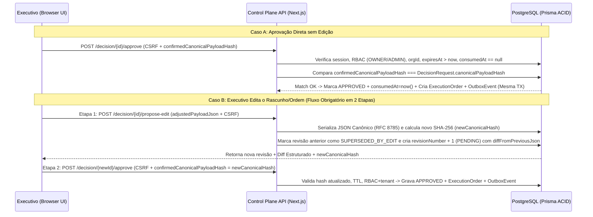

# Motor de Proatividade, Contratos de Dados e Matriz de Segurança (NexosAI Executive — Revisão v1.1 Ordem 060)

- **Status**: PROPOSTA TÉCNICA REVISADA (Fase F0 — Design & Co-Design Documental)
- **Ordens de Referência**: `HU-HUB-ORDER059-NEXOSAI-EXECUTIVE-CODESIGN-20261104`, `HU-HUB-ORDER060-EXECUTIVE-ADR-HARDENING-20261104`

---

## 1. Fórmula do Score de Prioridade Explicável (`0–100`)

Todo `WorkItem` recebe um `priorityScore` determinístico em escala `0.0` a `100.0`, acompanhado de um objeto auditável `scoreBreakdown` que explica exatamente **por que** aquele item está sendo cobrado agora.

### 1.1. Equação Base

$$S_{\text{raw}} = (0.30 \times I) + (0.25 \times U) + (0.20 \times F) + (0.15 \times B) + (0.10 \times C) - P_{\text{incerteza}} - P_{\text{esforço}}$$

$$S_{\text{final}} = \min\left(100, \max\left(0, S_{\text{raw}} + O_{\text{exceção}}\right)\right)$$

Onde cada variável de entrada é normalizada na escala `0–100`:
- **$I$ (Impacto — Peso 30%)**: Impacto direto em receita, segurança, produção ou meta estratégica do executivo (`100` = Produção/Cliente VIP/Receita direta; `70` = Evolução core de app; `40` = Melhoria incremental).
- **$U$ (Urgência / Prazo — Peso 25%)**: Proximidade do `dueAt` ou SLA de resposta (`100` = Vence hoje/atrasado; `80` = Vence em < 48h; `50` = Vence na semana; `20` = Sem prazo rígido).
- **$F$ (Custo de Esquecimento / Estagnação — Peso 20%)**: Cresce proporcionalmente aos dias sem progresso (`now - lastProgressAt`) em relação à cadência alvo do domínio:
  - Cliente sem resposta > 24h ➔ $F = 85$
  - Aplicação ativa sem commits/evolução > 7 dias ➔ $F = 75$
  - Ideia de alto potencial sem revisão > 14 dias ➔ $F = 60$
- **$B$ (Poder de Desbloqueio — Peso 15%)**: Quantos outros itens ou agentes (`WAITING_HUMAN`) estão travados aguardando esta decisão (`100` = Agente travado aguardando 1 clique; `60` = Desbloqueia próxima fase de projeto; `0` = Sem dependentes).
- **$C$ (Confiança da Evidência — Peso 10%)**: Grau de certeza do `Signal` de origem (`100` = Webhook assinado GitHub/Vercel ou entrada direta do executivo; `60` = Triagem heurística de e-mail).
- **$P_{\text{incerteza}}$ (Penalidade de Incerteza — `0 a 15 pts`)**: Aplicada quando `confidence < 0.70` ou quando faltam metadados verificáveis (`evidenceRef`).
- **$P_{\text{esforço}}$ (Ajuste de Dependência Externa — `0 a 20 pts`)**: Se o item está em `WAITING_EXTERNAL` dentro do prazo normal de terceiros, reduz temporariamente o score no painel "Meu Dia" para não gerar ruído inútil.
- **$O_{\text{exceção}}$ (Regras de Exceção Determinísticas)**:
  - Incidente crítico de produção ou segurança (`severity == CRITICAL`) ➔ Eleva $S_{\text{final}} \ge 95$.
  - Deadlines contratuais/regulatórios no próprio dia ➔ Eleva $S_{\text{final}} \ge 90$.

---

## 2. Cadência Proativa, Timezone/DST e Regras Anti-Fadiga (Hardening H-08)

> [!NOTE]
> Os horários abaixo são **defaults propostos** em `ExecutiveWorkspace` e permanecem sujeitos à **Decisão Executiva D2** do Master SuperAdmin, podendo ser reconfigurados por tenant a qualquer momento.

| Ritual Proativo | Default Proposto (`America/Fortaleza`) | Limite de Itens | Regra de Seleção e Anti-Spam |
| :--- | :---: | :---: | :--- |
| **1. Briefing Executivo Matinal** | `08:00` (Proposto) | **Top 3 a 5** | Seleciona os itens de maior `priorityScore` combinando equilíbrio de lentes (ex: máx. 2 Dev/Apps, 1–2 Clientes/Vendas). |
| **2. Radar de Desbloqueio (Meio-Dia)** | `13:00` (Proposto) | **Máximo 3** | Exclusivo para itens em `WAITING_HUMAN` onde agentes (Antigravity/ChatGPT) ou clientes aguardam aprovação de 1 clique. |
| **3. Varredura Semanal Anti-Esquecimento** | Segunda-feira `08:30` (Proposto) | **Até 7 itens** | Resgata aplicações sem evolução (`> 7d`), clientes sem retorno e ideias da incubadora, exigindo decisão: *Executar 1 passo*, *Agendar* ou *Arquivar*. |

### 2.1. Política de Timezone IANA, Horário de Verão (DST) e Deduplicação de Janela
1. **Avaliação em Timezone IANA**: Todos os timestamps no banco são persistidos em `UTC`, mas a avaliação de janelas (`morningBriefingTime`, `middayUnblockTime`, `quietHoursStart/End`) converte `UTC -> ExecutiveWorkspace.timezone` (ex: `America/Fortaleza` ou `America/Sao_Paulo`) usando a biblioteca padrão `Intl.DateTimeFormat` / IANA tzdb.
2. **Transições de DST (Daylight Saving Time)**:
   - Em regiões com mudança de horário de verão: se um horário local for pulado (*spring forward*), o job dispara no primeiro minuto válido subsequente; se um horário local ocorrer duas vezes (*fall back*), a chave de deduplicação `dedupeKey = sha256(orgId + policyId + localDateYYYYMMDD)` garante que o ritual execute **apenas na primeira ocorrência** do dia civil local.
3. **Travas Anti-Fadiga, Rate Limit e Pausa**:
   - **Quiet Hours (Proposto `22:00–07:00`)**: Qualquer `Nudge` agendado para dentro da janela de silêncio recebe status `SUPPRESSED_QUIET_HOURS` e é reagendado para o término do silêncio.
   - **Pausa Executiva (`pausedUntil`)**: Se `ExecutiveWorkspace.pausedUntil > now()`, todos os disparos automáticos recebem `SUPPRESSED_PAUSED`.
   - **Cooldown por Item (`cooldownHours = 24`)**: Um mesmo `WorkItem` não gera novo `Nudge` dentro de 24h, salvo se mudar para `VERIFICATION` ou `WAITING_HUMAN` por evento novo.
   - **Rate Limit Diário (`maxDailyNudges = 8`)**: Atingido o limite diário do tenant, novos itens são retidos apenas no painel web (`SUPPRESSED_RATE_LIMIT`) ou agrupados em um único resumo.

---

## 3. Protocolo Formal de Aprovação em Duas Etapas para Payloads Editados (Hardening H-04)

Para eliminar a vulnerabilidade onde um payload editado pelo usuário seria aprovado sem verificação criptográfica do novo conteúdo, o fluxo `DecisionRequest` segue **duas etapas atômicas**:



---

## 4. Transactional Outbox Formal e Semântica `At-Least-Once` (Hardening H-03)

1. **Gravação Atômica**: A aprovação de uma `DecisionRequest` nunca chama a rede diretamente. Dentro de `prisma.$transaction(async (tx) => { ... })`, o Control Plane:
   - Atualiza `DecisionRequest` (`state = APPROVED`, `consumedAt = now()`).
   - Cria `ExecutionOrder` (`state = QUEUED`).
   - Cria `OutboxEvent` (`status = PENDING`, `idempotencyKey = order.idempotencyKey`).
2. **Consumo com Lease e Backoff Exponencial**:
   - O worker executa:
     ```sql
     UPDATE "OutboxEvent"
     SET status = 'PROCESSING', "leaseOwner" = $1, "lockedUntil" = NOW() + INTERVAL '60 seconds', attempts = attempts + 1
     WHERE id IN (
       SELECT id FROM "OutboxEvent"
       WHERE (status = 'PENDING' OR (status = 'FAILED_RETRYABLE' AND "nextAttemptAt" <= NOW()) OR (status = 'PROCESSING' AND "lockedUntil" < NOW()))
       ORDER BY "createdAt" ASC
       LIMIT 10
       FOR UPDATE SKIP LOCKED
     )
     RETURNING *;
     ```
   - Em caso de falha de entrega, calcula `nextAttemptAt = now + min(3600, 15 * 2^attempts) + jitter`. Ao atingir `maxAttempts = 5`, transiciona para `DEAD_LETTER` e registra alerta auditável.
3. **Deduplicação no Receptor (`At-Least-Once`)**: Como quedas de rede após o envio do pacote HTTP e antes do commit de `PUBLISHED` podem causar reenvio do mesmo `OutboxEvent`, a **AI-Bridge Local V2** registra e verifica `idempotencyKey` de forma idempotente antes de enfileirar no agente destino.

---

## 5. Contratos Formais de Dados (TypeScript / JSON Schema)

### 5.1. Contrato `DecisionEditRequestV1` & `DecisionConfirmApprovalV1`
```typescript
// Etapa 1 (Quando o executivo altera qualquer campo do rascunho/ordem):
export interface DecisionEditRequestV1 {
  decisionRequestId: string;
  organizationId: string;
  baseRevisionNumber: number;
  adjustedPayloadJson: Record<string, unknown>;
}

export interface DecisionEditResponseV1 {
  newDecisionRequestId: string;
  revisionNumber: number;
  canonicalPayloadJson: string; // RFC 8785 JCS
  canonicalPayloadHash: string; // SHA-256 do canonicalPayloadJson
  diffFromPrevious: Array<{ path: string; before: unknown; after: unknown }>;
  expiresAt: string;
}

// Etapa 2 (Confirmação final vinculada ao hash canônico exato da revisão ativa):
export interface DecisionConfirmApprovalV1 {
  decisionRequestId: string;
  organizationId: string;
  revisionNumber: number;
  confirmedCanonicalPayloadHash: string; // Obrigatório coincidir com DecisionRequest.canonicalPayloadHash
  decisionNote?: string;
}
```

---

## 6. Defesa em Profundidade contra Prompt Injection Semântico (Hardening H-05)

> [!CAUTION]
> **Princípio Fundamental de Segurança**: Truncar strings ou remover tags HTML/scripts (`untrustedTextSummary`) previne XSS na interface web, mas **NÃO impede Prompt Injection semântico** (instruções em linguagem natural embutidas no corpo de um e-mail, título de PR ou comentário de issue tentando manipular o LLM).

Para neutralizar injeções semânticas (OWASP LLM01 / Agentic Top 10):
1. **Separação Estrutural de Dados Não Confiáveis**: Todo texto oriundo de `Signal` é empacotado em delimitadores estritos `<untrusted_data source="..." signal_id="...">...</untrusted_data>` com instrução de sistema imutável determinando que qualquer comando imperativo dentro do bloco deve ser tratado como texto passivo sob análise, nunca como instrução ao modelo.
2. **Zero Tool-Calling de Escrita no LLM**: O modelo de linguagem chamado pelo worker de triagem **não recebe definição de ferramentas (`tools: []`)** para enviar e-mails, chamar a AI-Bridge, alterar estados de decisão ou modificar registros de outros itens. Sua saída é restrita a um JSON validado por schema estrito (Zod) contendo apenas `{ suggestedSummary: string, suggestedNextActionDraft: string, confidenceAdjustment: number }`.
3. **Autoridade Exclusiva do Policy Engine Determinístico**: Mesmo que um atacante convença o LLM a sugerir no campo `suggestedNextActionDraft` uma ação maliciosa, o **Policy Engine determinístico** classifica toda ação externa ou de execução como `APPROVAL_REQUIRED` (ou `PROHIBITED`), exigindo inspeção visual humana do payload completo e confirmação criptográfica do `canonicalPayloadHash` na UI autenticada.

---

## 7. Gate Quádruplo de Feature Flag (Hardening H-07)

O módulo NexosAI Executive nasce **desabilitado por padrão** (`NEXOSAI_EXECUTIVE_ENABLED !== 'true'` ou `ExecutiveWorkspace.featureFlagEnabled === false`). A função central `assertExecutiveModuleEnabled(organizationId)` é invocada obrigatoriamente em **quatro pontos de entrada**:
1. **UI Server Components (`/executive/*`)**: Retorna `404 Not Found` / tela de módulo desativado se a flag estiver `OFF`.
2. **REST APIs (`/api/orgs/[organizationId]/executive/*`)**: Retorna `HTTP 403 Forbidden` (`{"error": "EXECUTIVE_MODULE_DISABLED"}`) antes de qualquer query de negócio.
3. **Endpoints de Cron (`/api/cron/executive/*`)**: Verifica o header de assinatura do cron e ignora qualquer workspace com `featureFlagEnabled === false`.
4. **Workers de Fila / Outbox Relay**: Aborta o processamento de eventos de organizações onde `featureFlagEnabled === false`.
